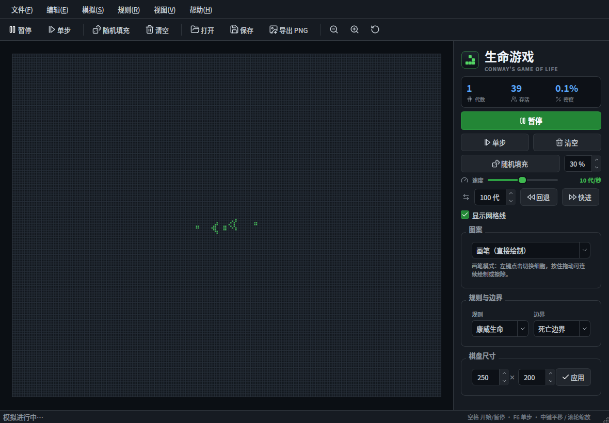
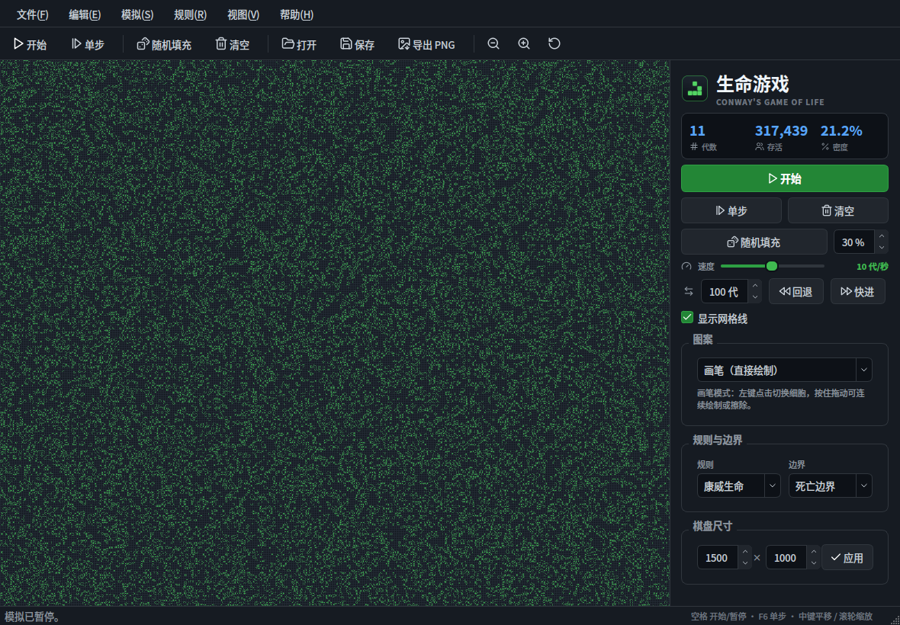

# 生命游戏 (life-game) —— Qt 5 / C++17 / 标准分层 MVC

康威生命游戏（Conway's Game of Life）的桌面实现。项目使用 **C++17 + Qt 5 Widgets**，
按**标准分层 MVC（被动视图）**组织：

- **Model** 只包含状态、规则和用例，不引用 View/Controller；
- **View** 是纯被动视图：不包含 Model 头文件、不连 Model 信号，只接收 Controller
  推送的只读数据和 `const domain::Grid*`，只发出用户意图；
- **Controller** 是唯一同时持有 Model 与 View 的协调层，负责“查询 Model → 更新 View”
  和“View 意图 → Model 命令”的双向转换。

它同时是一个**可执行的架构范例**：依赖方向由分层 CMake 目标和
`tools/check_layering.py` 共同约束。Domain/Shared 层不依赖 Qt；Model/Service/View
互不依赖，三者都只依赖 Domain + Shared 契约；Controller 依赖三者；App 只做组合。



1500 × 1000 大棋盘（150 万格，10 代/秒）渲染实测：



## 为什么值得作为范例

- **严格的 View→Model 隔离**：View 不包含 `model/` 任何头文件，只持有
  `const domain::Grid*` 和 `domain::LifeStats` 等值对象；Model 变化由 Controller
  连接信号后调用 View setter，View 自己不知道 Model 的存在。
- **Controller 是唯一中介**：输入从 View 信号进入 Controller，状态从 Model 信号
  经 Controller 推送回 View；没有 View→Model 的隐式观察链。
- **Domain 零框架依赖**：`src/domain` 不包含任何 Qt 头文件，可用普通 `g++` 单独编译测试。
- **可执行的架构门禁**：`tools/check_layering.py` 在 CTest 与 CI 中检查层间 include；
  CMake 目标本身也按层拆分。
- **并发与状态机可测试**：单代异步演化封装在 `SimulationEngine`；跳转重放在
  `LifeModel` 的后台任务中完成；快照历史使用 1 bit/cell 压缩；Model/View/Controller 各有 QtTest 覆盖。
- **错误码而非异常**：应用代码以 `-fno-exceptions` 编译；可恢复失败使用
  `model::CommandResult`、`service::FileError`、`service::SettingsError`、
  `domain::RleError` 等类型化错误码，Controller 负责映射成一条可操作的中文提示。
- **可运维日志**：五个 `QLoggingCategory`（app/model/io/controller/view）写入
  轮转文件，默认只记 Info/Warning/Critical，`--verbose` 才打开 debug；不会逐代/逐格刷日志。
- **工程化齐全**：CMake presets、CTest（8 个用例）、ASan/UBSan 选项、GitHub Actions、
  `.clang-format`、README 与架构文档。

## 功能

- **直接绘制**：左键点击切换细胞，按住拖动可连续绘制或擦除；快速拖动自动补齐中间格子
- **模拟控制**：开始 / 暂停、单步、随机填充、清空
- **代数跳转**：按指定代数回退或快进；跳转不逐代刷新界面，回退基于快照重放
- **可配置粒度**：跳转粒度、棋盘尺寸粒度、快照间隔，保存在 QSettings
- **速度调节**：0 – 120 代/秒（0 为暂停，正数对数刻度；大棋盘 View 更新合并到约 60 fps）
- **并行演化**：QtConcurrent + QThreadPool 按行分块；计算不占用 UI 线程
- **图案库**：13 种经典图案，选择后显示半透明预览，点击棋盘直接放置
- **规则切换**：康威生命、高地生活、昼与夜、种子、迷宫；支持 RLE 头部自定义 B/S
- **边界模式**：死亡边界与环绕边界
- **棋盘尺寸**：宽度 20–1500，高度 20–1000（最大 150 万格，x 轴为宽度）
- **视图操作**：滚轮缩放（1 – 48 px/格）、中键/右键拖动平移、网格线开关
- **文件**：打开 / 保存 RLE，导出 PNG 棋盘图片
- **状态统计**：代数、存活细胞数、密度（Model 缓存人口，`stats()` O(1)）
- **自动暂停**：手动编辑、清空、载入时自动暂停；检测到静物或空棋盘时停止并提示
- **安全操作**：清空/调整尺寸前中文确认；对话框按钮为中文；Space 不会抢走
  已聚焦按钮的键盘激活
- **会话续接**：退出时保存棋盘、代数、规则、边界、速度、密度、网格与窗口位置

## 操作

| 操作 | 方式 |
|---|---|
| 绘制 / 擦除 | 左键点击；按住拖动连续绘制 |
| 放置图案 | 在侧边「图案」中选择，点击棋盘 |
| 平移 | 中键或右键拖动 |
| 缩放 | 滚轮；或菜单「编辑 / 视图」中的缩放项 |
| 开始 / 暂停 | 空格 / 工具栏按钮 / 侧边主按钮 |
| 单步 | `F6` / 工具栏「单步」 |
| 回退 / 快进 | 侧边「跳转」行填写代数后点「回退 / 快进」；或 `Ctrl+Shift+← / →` |
| 设置 | `Ctrl+,` / 菜单「编辑 → 设置」 |
| 随机填充 | `Ctrl+R` |
| 清空 | `Ctrl+Delete` |
| 载入示例 | `Ctrl+D` |
| 打开 / 保存 RLE | `Ctrl+O` / `Ctrl+S` |
| 导出 PNG | `Ctrl+Shift+S` |
| 重置缩放 | `Ctrl+0` |
| 显示 / 隐藏网格 | `Ctrl+G` |
| 全屏 | `F11` |

## 图案库

| 分类 | 图案 |
|---|---|
| 静物 | 方块、蜂巢 |
| 振荡器 | 闪烁灯、蟾蜍、信标、脉冲星、五连珠 |
| 飞船 | 滑翔机、轻型飞船 |
| 增长 | 高斯帕滑翔机炮 |
| 长寿 | 橡果、R 五连体、死亡之翼 |

图案形状写在 `src/domain/pattern_library.cpp`，只使用稳定 ID + ASCII 艺术；
中文名称、分类与说明位于 `src/view/pattern_catalog.cpp`，两者通过 ID 关联。

## 规则

每个细胞只由周围 8 格中的存活数量决定。B/S 记号中，`B` 后是诞生所需的邻居数，
`S` 后是存活所需的邻居数。

| 名称 | 记号 | 备注 |
|---|---|---|
| 康威生命 | `B3/S23` | 默认规则 |
| 高地生活 | `B36/S23` | 具有自我复制行为的著名变体 |
| 昼与夜 | `B3678/S34678` | 对称性很强 |
| 种子 | `B2/S` | 所有活细胞都会死亡，靠新细胞扩散 |
| 迷宫 | `B3/S12345` | 容易生成迷宫状纹理 |

## 架构

完整契约见 **[docs/architecture.md](docs/architecture.md)**；
大棋盘渲染 profile 见 **[docs/rendering-profile.md](docs/rendering-profile.md)**；
独立审计（不引用文档作为证据）见 **[docs/architecture-audit.md](docs/architecture-audit.md)**。

### 分层

```
┌──────────────────────────── app ────────────────────────────┐
│ main.cpp · MainWindow（组合根）· 菜单 / 工具栏 / 状态栏       │
└───────────────────────────┬─────────────────────────────────┘
                            ▼
                       controller
                      ╱    │    ╲
                     ▼     ▼     ▼
                  view  model  service
                     ╲     │     ╱
                      ╲    ▼    ╱
                    domain  shared
```

| 层 | 目录 | 允许依赖 | 职责 |
|---|---|---|---|
| Domain | `src/domain` | 自身、C++ 标准库 | 棋盘、规则、图案、RLE、快照历史（纯业务） |
| Shared | `src/shared` | 自身、C++ 标准库 | `LifeStats`/`AppSettings`/`JumpInfo` 只读契约值对象 |
| Model | `src/model` | Domain、Shared、QtCore/QtConcurrent | 可观察状态、命令、异步演化；不引用 View/Controller |
| Service | `src/service` | Domain、Shared、QtCore/QtGui | QSettings、文件、PNG 编码；不引用 Model |
| View | `src/view` | Domain、Shared、QtWidgets | 被动绘制/控件；不引用 Model、Controller、Service |
| Controller | `src/controller` | Domain、Shared、Model、View、Service | 输入、Model→View 推送、View→Model 命令、定时器/对话框 |
| App | `src/app` | 全部 | 组合根与入口 |

### 分层 MVC 的数据流

用户绘制：

```
BoardView::cellPressed(row, col)
  → BoardController::onCellPressed
  → LifeModel::setCell(row, col, !alive)    // 命令
  → LifeModel 更新棋盘、人口、历史
  → LifeModel::boardChanged / statusChanged  // 广播
  → BoardController 查询 Model
  → BoardView::setBoard(const Grid*)         // 只传只读指针
  → ControlPanel::setStats(LifeStats)        // 被动 setter
```

模拟定时器：

```
QTimer::timeout
  → SimulationController::onTick
  → LifeModel::requestStep()
  → SimulationEngine 在 Qt 线程池按行并行计算
  → QFutureWatcher::finished
  → LifeModel::onStepReady() → applyStep()
  → boardChanged / statusChanged
  → BoardController 推送到 BoardView / ControlPanel
```

Controller **不**复制整块棋盘；它把 `const domain::Grid*` 交给 View，
因此每帧没有 160 KB 的棋盘拷贝，同时 View 也不知道 `LifeModel` 类型。

### 目录

```
CMakeLists.txt                分层 CMake 目标
CMakePresets.json             debug / release / asan 预设
docs/architecture.md          架构契约与评审清单
docs/performance.md           数据结构与并发性能报告
src/domain/                   纯业务 C++，无 Qt（含 1 bit/cell 快照 PackedGrid）
src/shared/                   跨层只读契约值对象（无 Qt、无行为）
src/model/                    可观察 Model + CommandResult + 异步管线
src/service/                  QSettings / RLE / PNG + FileError/SettingsError
src/view/                     自绘棋盘、面板、对话框、确认/提示、目录、主题
src/controller/               输入、会话、错误文案映射（按职责拆分）
src/app/                      组合根、日志 sink、main
tests/                        domain / model / view / controller / ui / logging
tools/check_layering.py       层间 include / 纯净度 / CMake 门禁
tools/layering_selftest.py    门禁负向 fixture
```

### 关键约束

- `BoardView` / `ControlPanel` 不包含任何 `model/` 头文件，不持有 `LifeModel*`；
  Controller 通过 `setBoard/setStats/setRunning/...` 推送显示状态。
- Controller 是除 App 组合根之外，唯一同时持有可写 Model 与 View 的层；
  View 的信号只连接到 Controller，Model 的信号也只由 Controller 消费。
- `LifeModel` 不包含 View/Controller/Service，也不出现 `QFile`、`QSettings`、`QFileDialog`
  或中文用户文案；Service 不依赖 Model/View/Controller。
- Domain/Shared 不包含 Qt；`LifeStats`/`AppSettings`/`JumpInfo` 位于 Shared，
  供 Model/Service/View/Controller 只读使用。
- 中文文案只出现在 View/Controller 和 App 外壳（菜单/标题/帮助），Model/Domain 不出现中文，
  UI 文案通过 `tr()` 提供翻译入口。

## 构建

需要 CMake ≥ 3.16、Ninja/Make、C++17 编译器与 Qt 5.9+（Widgets、Concurrent）；
测试与架构门禁还需要 Python 3。使用 `CMakePresets.json` 时需要 CMake ≥ 3.21。
默认开启 `LIFEGAME_NO_EXCEPTIONS=ON`（GCC/Clang 的 `-fno-exceptions`）：

```bash
sudo apt-get install -y cmake ninja-build g++ python3 qtbase5-dev

cmake -S . -B build -G Ninja -DCMAKE_BUILD_TYPE=Release
cmake --build build --parallel 8
./build/lifegame
```

如果系统同时安装了 Qt 6，CMake 可能优先找到 Qt 6；请显式指定 Qt 5：

```bash
cmake -S . -B build -G Ninja \
  -DCMAKE_PREFIX_PATH=/usr/lib/aarch64-linux-gnu/cmake \
  -DCMAKE_BUILD_TYPE=Release
```

或者使用预设：

```bash
cmake --preset debug
cmake --build --preset debug   # CMakePresets 中 jobs=8
ctest --preset debug
```

所有 build preset（`debug`/`release`/`asan`）都设置了 `"jobs": 8`，因此
`cmake --build --preset <name>` 默认 8 路并行；非预设命令请使用
`cmake --build build --parallel 8`。CI 也固定 `--parallel 8`。

Qt Creator 可直接打开根目录的 `CMakeLists.txt`。本项目不再维护 qmake 工程。

### 命令行与日志

```bash
./build/lifegame --help
./build/lifegame --verbose                 # 打开 lifegame.* 的 debug 日志
./build/lifegame --log-file /tmp/life.log  # 覆盖日志路径
```

默认日志位于 `QStandardPaths::AppLocalDataLocation/logs/life-game.log`
（Linux 通常为 `~/.local/share/life-game/life-game/logs/life-game.log`），
单文件 2 MiB × 3 份轮转。日志只记录低频状态迁移、文件/设置失败、模拟与跳转生命周期；
不会打印棋盘/RLE 正文、窗口几何或每代状态。`QT_LOGGING_RULES` 仍可覆盖默认过滤规则。

## 测试

```bash
cmake -S . -B build -G Ninja \
  -DCMAKE_BUILD_TYPE=Debug \
  -DLIFEGAME_WARNINGS_AS_ERRORS=ON
cmake --build build --parallel 8
ctest --test-dir build --output-on-failure
```

八个 CTest 用例：

| 用例 | 依赖 | 覆盖 |
|---|---|---|
| `domain_tests` | 无 Qt | 规则、Grid、边界、图案库、RLE（含恶意输入、行/列诊断、缺少 `!`）、PackedGrid、快照历史 |
| `model_tests` | QtCore | 演化、异步步进、停表、规则/边界、RLE 载入、跳转/取消、跳转中拒绝载入、错误码 |
| `view_tests` | QtWidgets | 速度刻度、滑块不回写、被动 setter、1500×1000 渲染/导出、设置对话框、进度框关闭 |
| `controller_tests` | QtWidgets | Bresenham、面板信号、绘制/图案、定时器、跳转方向/进度、Model→View 推送、文件路径、设置错误、会话恢复 |
| `ui_tests` | QtWidgets | 完整 MainWindow、确认/取消、Space、网格、1500×1000 渲染/模拟、截图 |
| `logging_tests` | QtCore | 文件 sink、category、verbose debug、轮转 |
| `layering` | Python | include 方向、绕过、CJK、CMake 清单与目标链接 |
| `layering_selftest` | Python | 架构门禁自身的负向 fixture |

UI 测试输出 `/tmp/lifegame-ui-tests.png`。CTest 为 UI 用例设置
`QT_QPA_PLATFORM=offscreen`，无需 Xvfb（CI 也可以直接用 xvfb-run）。

### 质量门禁

- 编译开启 `-Wall -Wextra -Wpedantic`；`LIFEGAME_WARNINGS_AS_ERRORS=ON` 时视为错误；
  默认 `-fno-exceptions`，异常在编译期被拒绝。
- `python3 tools/check_layering.py .` 检查 include 方向、`src/`/`..` 绕过、
  Domain/Shared/Model 的 Qt/中文纯净度、View/Service 的 Model 隔离、`CMakeLists.txt`
  源文件清单与 target 链接方向。
- `tools/layering_selftest.py` 用负向 fixture 验证门禁确实会失败。
- CI：普通构建 + ASan/UBSan 两个 job，均执行完整 CTest。
- 新增源文件必须显式加入 `CMakeLists.txt`（禁止 glob），并放入正确的层目录。

## 设计细节

- **定长 Grid**：`std::vector<Cell>` 只分配当前 `width × height` 的活动区域，每格 1 字节；
  同尺寸 `resize()` 不清零，避免每代重复清零。大棋盘（1500 × 1000 = 150 万格）
  约占 1.5 MB/棋盘，Grid 对象本身很小，不会压爆栈。
- **人口缓存**：Model 维护 `m_population`，`stats()` O(1)；View 不再逐帧扫描棋盘。
- **异步演化**：`SimulationEngine` 用 `QtConcurrent::mapped` 按行切片，
  `QFutureWatcher` 回 UI 线程；任务只读快照、只写自己的行区间。
- **背压与失效**：上一代仍在计算时忽略新的定时器请求；编辑/暂停/规则变化调用
  `discardPending()`，旧结果不会覆盖新状态。
- **快照回退**：生命游戏多对一、不可逆，因此按间隔存快照并正向重放；
  默认每 100 代一张，最多 64 张 + 锚点。快照使用 **1 bit/cell 的 `PackedGrid`**，
  1500 × 1000 最大棋盘约 187.5 KB/张，65 张约 12 MB（活棋盘仍是 1 byte/cell，
  保证模拟和渲染的热路径）。跳转在后台线程完成，
  UI 不逐代刷新，进度通过 queued invocation 回到 UI 线程。
- **View 无拷贝**：Controller 把 `const domain::Grid*` 传给 `BoardView`；演化中把每格
  压成一个像素后整块缩放贴图，暂停后恢复逐格矢量绘制。
- **导出上限**：PNG 使用固定 8 px/格，并把单边限制在 4096 px；不会因为缩放到
  1500 × 1000、48 px/格而申请数十 GiB 的 QImage；导出始终限制在 4096 边长内。
- **滑块不回写**：`ControlPanel` 只在外部载入设置时 `setSpeed`；Controller 在拖动
  过程中只重启定时器，不会把滑块"吸回"到近似位置。
- **大棋盘帧合并**：小棋盘立即刷新；运行中的大棋盘（>25 万格）最多约 60 fps
  更新 View，模拟本身仍按 0–120 代/秒推进。
- **随机填充**：Model 用高精度时钟与对象地址混合出种子（避免 `std::random_device`
  可能抛异常），因此每次结果不同；`Grid::randomize(density, seed)` 仍保留显式种子，
  便于测试与复现。
- **设置持久化**：`SettingsStore` 负责 QSettings 键；`SessionController` 负责启动恢复
  与退出保存；密度、速度、网格、规则、边界、代数、窗口几何都会往返。
- **错误分层**：Domain 用 `RleError` 枚举；Model 用 `CommandResult`；Service 用
  `FileError`/`SettingsError` 并附可选系统详情；Controller 统一映射为一条中文提示；
  Model 不产生用户文案。可恢复错误不使用异常；分配失败被视为不可恢复（进程终止）。
- **日志分层**：`app/logging` 是唯一安装 `qInstallMessageHandler` 的地方；
  model/service/controller/view 各自拥有 `Q_LOGGING_CATEGORY`，Domain 不引入 Qt 日志。

## C++17 用法

项目不是"为了用 C++17 而用 C++17"，性能相关的用法只出现在有收益的地方：

- `std::string_view`：RLE/规则/图案查找全程借用，不复制字符串。
- `std::optional`：`RleDecodeResult` 用值语义表达"成功/失败"，不做异常控制流。
- `std::clamp` / `inline constexpr`：尺寸、密度、速度、快照范围共享同一组编译期常量。
- `constexpr`：`Rule` 的构造、`births/survives`、`Grid::width/height`、
  错误名、设置范围与 `shared::normalized` 可在编译期求值；测试中有 `static_assert`。
- 移动语义：`Grid` 使用 `std::vector` 活动存储并支持 `noexcept` move；
  `SimulationEngine` 把结果 move 给 Model，`LifeModel::applyStep` 再 move 进棋盘，
  避免 1.5 MB 棋盘的深拷贝。`static_assert` 验证 `Grid`/`Rule` 的 nothrow move。
- `std::from_chars`：RLE 头部整数解析不再走 `stoi`/手动乘加，且不分配。
- `std::to_chars`：RLE 编码的游程长度写入栈上缓冲区，避免每个 run 一次
  `std::to_string` 分配；大棋盘导出 RLE 时减少分配抖动。
- 没有强行使用 `if constexpr`：当前热路径没有类型相关的编译期分支，加它只会增加
  阅读成本；算法、缓存布局和 `QImage` 路径才是大棋盘性能的主要杠杆。

## 性能

详见 **[docs/performance.md](docs/performance.md)**。历史测量（8 核 aarch64 / Qt 5.15）：

| 项目 | 提升 |
|---|---:|
| `Grid` 串行演化 vs 旧 `LifeBoard` | 约 **6.8 – 7.9×** |
| 400 × 400 并行计算 vs 新串行 | **2.53×**（历史数据） |
| 400 × 400 异步管线 vs 旧同步 | 约 **19.7×** 吞吐（历史数据） |
| UI 线程每代阻塞（400 × 400） | 11.49 ms → **0.172 ms**（历史数据） |

100 × 70 等小棋盘上并行派发开销大于收益，因此只在面积 ≥ 20,000 格时多分块；
主要收益来自固定数组 Grid、人口缓存与异步解耦。

## 已知限制

- 棋盘为有限尺寸：宽度最大 1500，高度最大 1000；位压缩快照最高约 12 MB。
- 不提供撤销/重做；
- 单步按钮在 UI 线程同步计算一代；连续模拟完全异步；
- 并行计算使用 Qt 全局线程池，若应用其他部分占用大量池线程，模拟会自动排队；
- 回退范围受快照间隔与 64 张上限约束；
- 当前只提供中文文案；`tr()` 已就位，但未附带 `.ts` 翻译文件；
- 文件对话框不记忆上次打开目录；
- 日志文件不处理多实例并发轮转；
- 分配失败/OOM 被视为不可恢复（`-fno-exceptions` 下进程终止），不会弹错误框；
- 未提供 `.desktop`/安装包集成，仅提供 CMake install 规则。

## 第三方资源

- 工具栏与按钮图标来自 [Lucide](https://lucide.dev)（ISC License），
  许可证见 `resources/icons/LICENSE-lucide.txt`。

## 许可

MIT，见 [LICENSE](LICENSE)。
